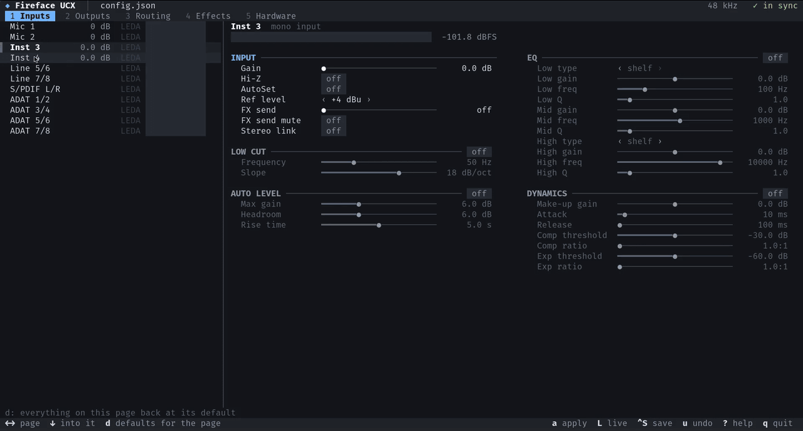

# Fireface UCX on Linux



A Linux driver and tools for the **RME Fireface UCX** (the first generation,
USB) in its native "RME driver" mode.

In Class Compliant mode the UCX already works on Linux through
snd-usb-audio, but only as a plain audio interface: the mixer, the DSP
effects and most settings can only be reached from RME's TotalMix on
Windows or macOS. This project gives Linux the unit's full feature set:

- **`snd-fireface-ucx`**, an ALSA kernel driver: 18 channels in and out at
  32–192 kHz, both MIDI ports, and an ALSA control for every part of the
  unit's mixer and DSP that is understood: routing, input gain and phantom
  power, EQ, dynamics, Auto Level, reverb, echo, loopback, clock and
  digital I/O settings. Front-panel changes show up live.
- **`ucxtui`**, a TotalMix-style mixer in the terminal.
- **`ucxcfg`**, which makes the unit match a JSON file, and applies your own
  setup whenever the unit is plugged in.

The protocol was worked out by reverse engineering RME's Windows driver and
TotalMix, and checked on a real unit. [`docs/PROTOCOL.md`](docs/PROTOCOL.md)
describes it.

> **Status: experimental.** It has been used daily on one unit, on Linux
> 6.18. It is not affiliated with or supported by RME. See [Safety](#safety).

## What works

| | |
|---|---|
| Playback and capture | 18 channels up to 48 kHz, 14 up to 96 kHz, 12 up to 192 kHz; `S32_LE` with 24 bits |
| Latency | 3.5 ms round trip through PipeWire at 48 kHz, quantum 32 |
| MIDI | both ports |
| Mixer | every input and playback channel to every output, plus the FX send bus |
| DSP | low cut, 3-band EQ, dynamics, Auto Level per channel; reverb and echo |
| Settings | input gain, 48 V, Inst/Hi-Z, reference levels, AutoSet, loopback, clock source, clock frequency per rate family (varipitch), word clock, S/PDIF and ADAT options |
| Meters | all five meter banks |
| System | hot plug, unplugging while playing, suspend and resume |

Not supported: storing setups to the unit's flash (deliberately, see
below), the newer UCX II, and other Fireface models.

## Requirements

- A Fireface UCX in **RME driver mode**. `lsusb` shows `2a39:3fc9` (or
  `0424:3fc9`). If it shows `3fb9`, the unit is in Class Compliant mode:
  switch it back as RME's manual describes.
- Linux with headers for the running kernel. It was developed on 6.18.
- To build: `make`, a C compiler, `pkg-config`, alsa-lib and jansson, plus
  libusb for `ucxctl`.

## Install

### NixOS

Add the flake as an input and import its module, which builds the driver
for your kernel and installs the tools, the udev rule, the user service and
the WirePlumber profile and latency rules:

```nix
# flake.nix
inputs.fireface-ucx.url = "github:realbogart/fireface-ucx-linux";

# in your NixOS configuration
imports = [ inputs.fireface-ucx.nixosModules.default ];
```

### Other distributions

```sh
make                          # driver and tools
sudo make install-module      # the driver, into /lib/modules/$(uname -r)/updates
sudo make install PREFIX=/usr # ucxcfg, ucxtui, udev rule, systemd user unit,
                              # PipeWire card profile and WirePlumber rules
```

The driver loads by itself when the unit is plugged in. Rebuild and
reinstall it after each kernel upgrade. To try it without installing,
use `sudo insmod kmod/snd-fireface-ucx.ko`.

## Use

The unit appears as the ALSA card `UCX`. Any ALSA, JACK or PipeWire
application can use it.

With **PipeWire and WirePlumber**, choose the UCX card profile in your sound
settings according to the session rate.

| Card profile | Hardware rate | Playback and capture |
|---|---|---|
| **Pro Audio** | 32, 44.1 or 48 kHz | 18 channels each, including ADAT 1–8 |
| **Fireface UCX 96 kHz (14 channels)** | 96 kHz | 14 channels each, including ADAT 1–4 |

The 96 kHz profile sets the graph rate while the UCX is active. Switching
profiles recreates its playback and capture ports. Applications or patchbays
that target a node by name should use the `.ucx-96k` sink and source for
that session. Select **Pro Audio** again to return to the 18-channel
layout (48 kHz with the default graph settings).

To switch from the terminal, find the UCX card under **Devices** in
`wpctl status` and substitute its number for `ID`. After first installing
the profile, run `systemctl --user restart wireplumber` to load the rules.

```sh
pw-cli set-param ID Profile '{ name: "ucx-96k" }'    # 96 kHz session
pw-cli set-param ID Profile '{ name: "pro-audio" }'  # return to single speed
```

While playing and recording, check the hardware rate and channel count
with `cat /proc/asound/UCX/pcm0{p,c}/sub0/hw_params`.

In **Pro Audio**, the unit and driver add 105 frames to the round trip at
single speed. The installed WirePlumber rule
([`wireplumber/51-fireface-ucx-latency.conf`](wireplumber/51-fireface-ucx-latency.conf))
adds them, so a DAW that compensates for reported latency lines up a
recording with what it played; don't also set a manual recording offset in
the DAW. The values are for the driver's default `urb_blocks=2`; the file
says what to change for 4. The 96 kHz profile has no calibrated latency offset.

**`ucxtui`** is the mixer: inputs, outputs, routing, effects and settings,
with meters. Changes are sent when you apply them, or as you make them in
live mode. It saves to `~/.config/ucx/config.json`.
[`docs/TUI.md`](docs/TUI.md) is its manual.

**`ucxcfg`** does the same from the command line:

```sh
ucxcfg dump > my.json        # what the unit is set to now
ucxcfg apply -n my.json      # show what would change
ucxcfg apply my.json         # make it so
```

A short example that routes the computer's first two channels to the line
outputs and the headphones:

```json
{
  "version": 1,
  "outputs": {
    "Line 1/2":   { "volume": 0,   "mix": { "PCM 1/2": 0 } },
    "Phones L/R": { "volume": -20, "mix": { "PCM 1/2": 0 } }
  }
}
```

The unit keeps its settings while it is switched off, but it can't report
everything back: the playback routing, for example. So the installed udev
rule applies `~/.config/ucx/config.json` whenever the unit appears.
[`docs/CONFIG.md`](docs/CONFIG.md) describes the file, and `examples/` has
more.

All settings are also plain ALSA controls (`alsamixer -c UCX`,
`amixer -c UCX`), but there are many of them, so the two tools are easier.

## Safety

- The unit can store setups in its flash memory. The driver and the tools
  never do this, and the driver refuses the commands that would. If you
  experiment with the protocol yourself, never send vendor requests
  `0x18`/`0x19` or DSP words for registers `0x3e05`/`0x3e06`.
- Changing the clock source to an input without a signal can stop audio
  until it is changed back.
- The unit accepts DSP commands only about as fast as 12 per millisecond.
  A program that floods the hwdep device can make the command endpoint
  stop for up to two minutes. The driver's own controls are paced.

## For developers

- [`docs/PROTOCOL.md`](docs/PROTOCOL.md) and
  [`include/ucx_proto.h`](include/ucx_proto.h): the protocol, with the
  address in the Windows driver that each fact came from.
- `kmod/`: the driver. `ucx_pcm.c` streams, `ucx_mixer.c` holds the
  controls, `ucx_main.c` handles probe, MIDI and power management.
- `lib/`, `tools/ucxcfg.c`, `tui/`: the config library and the two tools.
  `make check` runs the tests, which need no unit, and `make fuzz` fuzzes
  the config parser.
- `make check-pcm` tests PCM recovery and channel alignment with simulated
  USB completions. See [Testing PCM recovery](docs/PCM-TESTING.md) for the
  fault-injection test on a unit.
- `tools/ucxctl.c` (`build/ucxctl`): talks to the unit over libusb, without
  the driver, to test protocol guesses safely in user space. It needs the
  driver unloaded.
- `tools/ucxdsp.py`: raw DSP words, the register table and meters through
  the driver's hwdep device, no root needed. `routes.py`, `inprobe.sh`,
  `tone.py`, `looptest.c` and `ratetest.sh` are the measurement helpers
  used to verify the map, and `midi_*.py` test MIDI out.

`nix develop` gives a shell with everything needed.

## How it was made

RME publishes no protocol documentation for the UCX's driver mode, so it
was worked out from RME's Windows driver and TotalMix FX. The disassembly
was done with [Claude Code](https://claude.com/claude-code) driving
[REA](https://github.com/morluto/rea), which gives an AI agent Ghidra,
rizin and other reverse-engineering tools. That found the USB interfaces,
the vendor requests, how the streams are started and how TotalMix encodes
its mixer and DSP commands. Each finding was then tried from user space
with `ucxctl` before it went into the kernel driver.

The binaries only tell part of the story. Filling in the blanks took a lot
of manual testing: cables looped from outputs to inputs, quiet test tones,
the unit's own meters and front panel, one register at a time, until every
control in the driver did what it says on the actual hardware.
`docs/PROTOCOL.md` marks what was verified that way.

## Credits

Thanks to RME for the Fireface UCX: a great-sounding, solidly built
interface with a remarkably capable DSP mixer, still going strong many
years on. This project exists because the hardware deserves to keep
working on any system.

The DSP command format is shared with RME's FireWire Fireface "latter"
protocol. Takashi Sakamoto's
[snd-firewire-ctl-services](https://github.com/alsa-project/snd-firewire-ctl-services)
and Michael Forney's [oscmix](https://github.com/michaelforney/oscmix) (for
the UCX II and 802) documented much of it.

## License

MIT, see [LICENSE](LICENSE): use it for anything, including other drivers,
mixers and closed-source projects. The kernel driver (`kmod/`) and the
protocol headers (`include/`) are dual-licensed MIT or GPL-2.0
([LICENSES/](LICENSES/)), so the driver can load as a GPL-compatible
module and be merged into Linux.

RME, Fireface and TotalMix are trademarks of RME Audio. This project is not
affiliated with RME.
